# Initial ERD

Tables are created only through TypeORM migrations (`apps/api/src/database/migrations`).

Implemented so far: `users`, `refresh_tokens` (Stage 03); `households`, `household_members`, `household_invitations`, `audit_events` (Stage 04); `categories`, `income_records`, `transactions`, `transaction_allocations` (Stage 05); `settlements` (Stage 06); `recurring_expenses`, `recurring_occurrence_skips`, `installment_plans` and the origin columns of `transactions` (Stage 07 — `recurring_expenses` has no `day_of_month`/`status` columns: the day comes from `start_date`, the status is derived from `end_date` and `pauses`); `budgets` (Stage 08 — months stored as `from_month`/`until_month` dates instead of the proposed `effective_*_month`); `goals`, `goal_contributions`, `purchase_plans`, `purchase_plan_items` (Stage 09 — goals and plans are archived via `archived_at` instead of a stored `status`; the status is derived). `insight_dismissals` (Stage 11). Stage 05 deviations from the proposal below: `categories` has no `icon`/`color` yet (UI polish later); `transaction_allocations.weight` is `bigint` (cents for CUSTOM_AMOUNT); recurrence/installment origin columns arrived with Stage 07. `audit_events` intentionally has **no foreign keys** (the log must outlive anonymized/removed records). Invitation status is stored as `PENDING | ACCEPTED | REVOKED`; `EXPIRED` is derived from `expires_at`. Constraint names are explicit (`pk_`, `uq_`, `fk_`, `ck_`, `ix_` prefixes); `pnpm --filter @couple-finance/api migration:check` fails if entities and migrations drift.

Conventions (ADR-002, ADR-003, ADR-008):
- `id uuid` primary keys, UUIDv7 generated by the application (time-ordered, index-friendly).
- Money: `*_cents bigint` with `CHECK (... >= 0)` or `> 0` as stated.
- Date-only: `date`. Instants: `timestamptz` (UTC).
- Every household-owned table has `household_id uuid NOT NULL` and indexes leading with it.
- Financial tables carry `created_at`, `updated_at`, `deleted_at`, and `version int` where editable.
- snake_case in the database, camelCase in TypeScript/API.

```mermaid
erDiagram
  users ||--o{ refresh_tokens : has
  users ||--o{ household_members : "is member via"
  users ||--o{ insight_dismissals : dismisses
  households ||--o{ insight_dismissals : scopes
  households ||--o{ household_members : has
  households ||--o{ household_invitations : issues
  households ||--o{ categories : owns
  categories ||--o{ categories : "parent of"
  households ||--o{ transactions : owns
  transactions ||--|{ transaction_allocations : "split into"
  household_members ||--o{ transaction_allocations : "responsible for"
  household_members ||--o{ transactions : pays
  categories ||--o{ transactions : classifies
  household_members ||--o{ income_records : earns
  households ||--o{ recurring_expenses : owns
  recurring_expenses |o--o{ transactions : "confirmed as"
  households ||--o{ installment_plans : owns
  installment_plans |o--|{ transactions : "installments are"
  households ||--o{ budgets : owns
  categories |o--o{ budgets : scopes
  households ||--o{ goals : owns
  goals ||--o{ goal_contributions : receives
  households ||--o{ purchase_plans : owns
  purchase_plans ||--o{ purchase_plan_items : contains
  goals |o--o{ purchase_plans : funds
  transactions |o--o| purchase_plan_items : pays
  households ||--o{ audit_events : records
  households ||--o{ settlements : records

  users {
    uuid id PK
    citext email UK
    text password_hash
    text display_name
    timestamptz created_at
    timestamptz updated_at
    timestamptz deleted_at
  }
  refresh_tokens {
    uuid id PK
    uuid user_id FK
    uuid family_id
    char64 token_hash UK
    timestamptz expires_at
    timestamptz created_at
    timestamptz rotated_at
    uuid replaced_by_id
    timestamptz revoked_at
    text revoked_reason "LOGOUT|REUSE_DETECTED"
  }
  households {
    uuid id PK
    text name
    char3 currency
    text timezone
    text default_split_type
    jsonb default_split_weights
    int version
    timestamptz archived_at
  }
  household_members {
    uuid id PK
    uuid household_id FK
    uuid user_id FK
    text role "OWNER|MEMBER"
    text status "ACTIVE|LEFT|REMOVED"
    text income_visibility "EXACT|RATIO_ONLY"
    timestamptz joined_at
    timestamptz left_at
  }
  household_invitations {
    uuid id PK
    uuid household_id FK
    citext email
    text token_hash UK
    uuid invited_by_member_id FK
    text status
    timestamptz expires_at
    uuid accepted_by_user_id
    timestamptz accepted_at
  }
  categories {
    uuid id PK
    uuid household_id FK
    uuid parent_id FK
    text name
    text icon
    text color
    bool is_system
    timestamptz archived_at
  }
  transactions {
    uuid id PK
    uuid household_id FK
    text description
    bigint amount_cents
    date date
    uuid category_id FK
    uuid payer_member_id FK
    text payment_method
    text notes
    text_array tags
    text split_type
    jsonb split_snapshot
    uuid recurring_expense_id "no FK (Stage 07)"
    date occurrence_date
    uuid installment_plan_id "no FK (Stage 07)"
    int installment_number
    int installment_count
    bool installment_payoff
    uuid created_by_member_id FK
    int version
    timestamptz deleted_at
    uuid deleted_by_member_id
  }
  transaction_allocations {
    uuid id PK
    uuid transaction_id FK
    uuid member_id FK
    bigint amount_cents
    int weight
  }
  income_records {
    uuid id PK
    uuid household_id FK
    uuid member_id FK
    bigint monthly_amount_cents
    date effective_from
    date effective_to
    timestamptz deleted_at
  }
  recurring_expenses {
    uuid id PK
    uuid household_id FK
    text description
    uuid category_id FK
    bigint expected_amount_cents
    text amount_type "FIXED|VARIABLE"
    text frequency "WEEKLY|MONTHLY|YEARLY"
    int interval "1-12"
    date start_date "anchors the day"
    date end_date
    uuid payer_member_id FK
    text payment_method
    jsonb split_rule "null = household default"
    text notes
    jsonb pauses "[{from, to}]"
    uuid created_by_member_id FK
    int version
    timestamptz deleted_at
    uuid deleted_by_member_id
  }
  recurring_occurrence_skips {
    uuid id PK
    uuid recurring_expense_id FK
    date occurrence_date
    uuid created_by_member_id FK
    timestamptz created_at
  }
  installment_plans {
    uuid id PK
    uuid household_id FK
    text description
    uuid category_id FK
    bigint original_total_cents
    int installment_count
    date first_installment_date
    uuid payer_member_id FK
    text payment_method
    jsonb split_snapshot
    text notes
    uuid created_by_member_id FK
    text close_kind "CANCEL|PAY_OFF"
    timestamptz closed_at
    uuid closed_by_member_id
    timestamptz deleted_at
    uuid deleted_by_member_id
  }
  budgets {
    uuid id PK
    uuid household_id FK
    uuid category_id FK "null = household total"
    bigint amount_cents
    date from_month "first day"
    date until_month "exclusive, null = open"
    uuid created_by_member_id FK
    timestamptz deleted_at
    uuid deleted_by_member_id
  }
  goals {
    uuid id PK
    uuid household_id FK
    text name
    bigint target_amount_cents
    date target_date
    uuid_array participant_member_ids
    uuid created_by_member_id FK
    int version
    timestamptz created_at "app clock"
    timestamptz archived_at
  }
  goal_contributions {
    uuid id PK
    uuid goal_id FK
    uuid member_id FK
    text type "CONTRIBUTION|WITHDRAWAL"
    bigint amount_cents
    date date
    text notes
    uuid created_by_member_id FK
    timestamptz deleted_at
  }
  purchase_plans {
    uuid id PK
    uuid household_id FK
    text name
    text description
    uuid goal_id FK
    uuid created_by_member_id FK
    int version
    timestamptz archived_at
  }
  purchase_plan_items {
    uuid id PK
    uuid purchase_plan_id FK
    text name
    bigint estimated_price_cents "unit"
    int quantity
    text priority
    text status
    bigint paid_price_cents "whole line"
    date purchased_at
    uuid transaction_id FK
    uuid responsible_member_id FK
    text url
    text notes
    int version
    timestamptz deleted_at
  }
  settlements {
    uuid id PK
    uuid household_id FK
    uuid from_member_id FK
    uuid to_member_id FK
    bigint amount_cents
    date date
    text notes
    uuid created_by_member_id FK
    timestamptz created_at
    timestamptz deleted_at
    uuid deleted_by_member_id
  }
  audit_events {
    uuid id PK
    uuid household_id FK
    uuid actor_user_id FK
    text entity_type
    uuid entity_id
    text action
    jsonb before
    jsonb after
    text request_id
    timestamptz occurred_at
  }
  insight_dismissals {
    uuid household_id PK
    uuid user_id PK
    text fingerprint PK
    timestamptz dismissed_at
  }
```

## Key constraints

| Table | Constraint |
|---|---|
| `users` | unique `email` (citext); `ck_users_display_name_length` 1–60. |
| `refresh_tokens` | unique `token_hash`; FK to users `ON DELETE CASCADE`; `revoked_reason` in (`LOGOUT`, `REUSE_DETECTED`). |
| `household_members` | partial unique `(household_id, user_id) WHERE status = 'ACTIVE'`; partial unique `(household_id) WHERE role = 'OWNER' AND status = 'ACTIVE'` (at most one active owner). Active-member cap enforced in application with a row lock on the household (`SELECT … FOR UPDATE`); lock order is always household → invitation. |
| `household_invitations` | unique `token_hash`; partial unique `(household_id, email) WHERE status = 'PENDING'`. |
| `categories` | unique `(household_id, coalesce(parent_id, '00000000-…'), lower(name)) WHERE archived_at IS NULL`; depth ≤ 2 in application. |
| `transactions` | `CHECK amount_cents > 0`; `ck_transactions_recurring_origin` / `ck_transactions_installment_origin` (all-or-nothing, number within count) / `ck_transactions_single_origin`; partial unique `ux_transactions_recurring_occurrence (recurring_expense_id, occurrence_date)` and `ux_transactions_installment (installment_plan_id, installment_number)`, both `WHERE deleted_at IS NULL`. Origin columns have **no FKs** so the ledger does not depend on the commitments modules (Stage 07). |
| `recurring_expenses` | `CHECK interval BETWEEN 1 AND 12`; `end_date >= start_date`; frequency, amount type and payment method enumerations. |
| `recurring_occurrence_skips` | unique `(recurring_expense_id, occurrence_date)`; FK `ON DELETE CASCADE`. |
| `transaction_allocations` | unique `(transaction_id, member_id)`; `CHECK amount_cents >= 0`; deferred constraint triggers `trg_transaction_allocations_balance` / `trg_transactions_balance` (function `assert_allocations_balance`) assert `Σ = transactions.amount_cents` at commit. |
| `income_records` | `EXCLUDE USING gist (member_id WITH =, daterange(effective_from, effective_to) WITH &&) WHERE deleted_at IS NULL` (requires `btree_gist`). |
| `budgets` | `ex_budgets_no_overlap EXCLUDE USING gist (household_id =, COALESCE(category_id, zero-uuid) =, daterange(from_month, until_month) &&) WHERE deleted_at IS NULL`; `ck_budgets_months` (first days, until > from); amount range (Stage 08, ADR-014). |
| `installment_plans` | `CHECK installment_count BETWEEN 2 AND 72`; `close_kind` and `closed_at` set together. |
| `goals` | `cardinality(participant_member_ids) >= 1`; name 1–60; target range (Stage 09). |
| `insight_dismissals` | PK `(household_id, user_id, fingerprint)`; `ck_insight_dismissals_fingerprint_length` 1–120; FKs to households and users (Stage 11, ADR-017). |
| `goal_contributions` | type in (CONTRIBUTION, WITHDRAWAL); amount > 0. Non-negative goal balance enforced in application under a row lock on the goal (ADR-015). |
| `purchase_plan_items` | `ck_purchase_plan_items_purchase`: PURCHASED ⇔ paid price and purchase date set; a linked expense only when PURCHASED; quantity 1–999. |
| `audit_events` | append-only (no UPDATE/DELETE grants to app role, Stage 13). |

## Initial indexes (justified by known queries)

| Index | Query |
|---|---|
| `transactions (household_id, date DESC, id DESC) WHERE deleted_at IS NULL` | list + cursor pagination; monthly aggregates |
| `transactions (household_id, category_id, date) WHERE deleted_at IS NULL` | category analytics, budgets |
| `transactions (household_id, date DESC, id DESC) WHERE deleted_at IS NOT NULL` (Stage 12) | "Excluídas" list and restoring an installment plan; without it both were full-table scans (EXPLAIN) |
| `transaction_allocations (member_id)` + PK lookup by `transaction_id` | contribution metrics |
| `household_members (user_id) WHERE status='ACTIVE'` | resolve households for a user / membership guard |
| `income_records (member_id, effective_from)` | basis lookup by date |
| `refresh_tokens (family_id)` | family revocation |
| `audit_events (household_id, entity_type, entity_id, occurred_at)` | entity history |

Further indexes are added only with an `EXPLAIN` justification in the stage that needs them.
